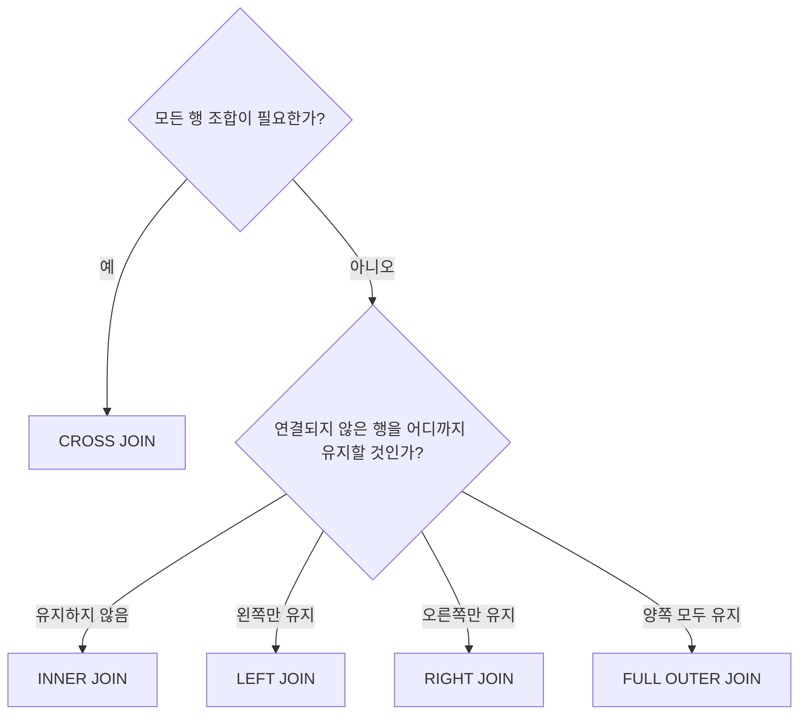
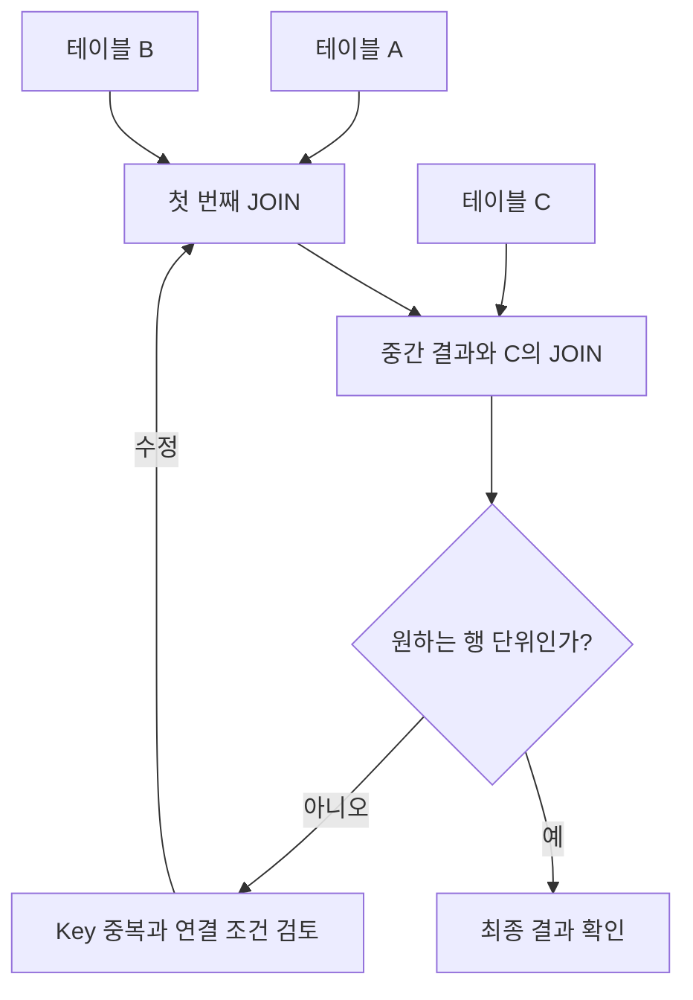
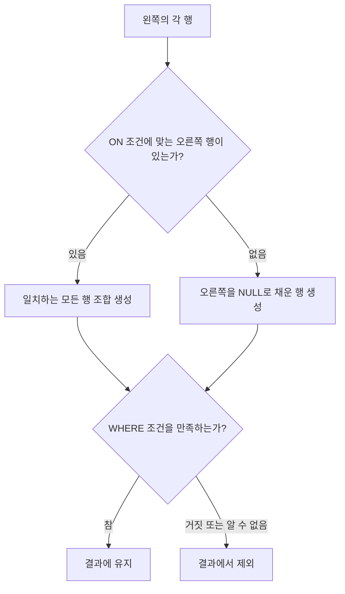

# 📘 SQL_BASIC 6주차 정규 과제

SQL_BASIC 정규 과제는 매주 정해진 분량의 `초보자를 위한 BigQuery(SQL) 입문` 강의를 듣고, 핵심 개념을 정리한 뒤 간단한 SQL 문제를 직접 풀어보는 방식으로 진행합니다.

이번 주는 SQL 입문 과정의 핵심 고비인 `JOIN`을 학습합니다.

JOIN은 여러 테이블을 연결해서 분석 질문에 답하기 위해 반드시 필요한 개념입니다. 이번 주 과제에서는 정답 코드뿐 아니라 **어떤 테이블을 어떤 키로 연결했는지**를 꼭 기록해주세요.

완성된 과제는 Github에 업로드하고, 링크를 스프레드시트 'SQL' 시트에 입력해 제출해주세요.

**👀 수행 인증란은 필수입니다.**

---

## 📚 SQL_BASIC_6th_TIL

### 섹션 6. 다량의 자료를 연결 : JOIN

### 5-2. JOIN 이해하기

### 5-3. 다양한 JOIN 방법

### 5-4. JOIN 쿼리 작성하기

### 5-5. JOIN을 처음 공부할 때 헷갈리는 부분

---

## ✨ 선택 강의

- 5-6. JOIN 연습문제: JOIN 문제를 더 연습하고 싶을 때 선택 수강

---

## 🏁 전체 강의 수강 계획

| 주차 | 필수 강의 범위 | 선택 강의 | 완료 여부 |
| --- | --- | --- | --- |
| 1주차 | 1-1 ~ 2-1 | 1 | ✅ |
| 2주차 | 2-2 ~ 2-3 | 2-4 | ✅ |
| 3주차 | 2-5, 2-7 ~ 2-8 | 2-6 | ✅ |
| 4주차 | 3-2 ~ 4-3 | 3-4 | ✅ |
| 5주차 | 4-4 ~ 4-6 | 4-5, 4-7 | ✅ |
| 6주차 | 5-2 ~ 5-5 | 5-6 | ✅ |
| 7주차 | 필수 강의 없음 | 6-2, 6-3, 6-4, 6-5 | 🍽️ |

---

<br>

<!-- 여기까진 그대로 둬 주세요-->

# 1️⃣ 개념 정리

---

## 📑 목차

1. [JOIN 기본 개념](#join-basic)
2. [JOIN이 필요한 이유](#join-why)
3. [JOIN의 종류](#join-type)
4. [JOIN 선택 기준](#join-choice)
5. [JOIN 쿼리 작성 흐름](#join-flow)
6. [JOIN 기본 문법](#join-syntax)
7. [여러 테이블 JOIN](#multi-join)
8. [JOIN에서 헷갈리기 쉬운 부분](#join-caution)
9. [NULL](#join-null)
10. [JOIN 핵심 정리](#join-summary)

---

<a id="join-basic"></a>

# SQL JOIN 정리

> **JOIN은 연결 조건을 기준으로 여러 테이블의 행을 조합하여, 필요한 정보를 함께 조회하는 SQL 문법이다.**
>
> 핵심은 **테이블 구조 파악 → 연결 관계 확인 → 유지할 데이터 결정 → 조건 작성 → 결과 검증**에 있음.

---

## 01. JOIN 기본 개념

JOIN은 여러 테이블에 나뉘어 저장된 데이터를 연결하여 하나의 조회 결과로 구성하는 문법이다.

단순히 테이블을 붙이는 것이 아니라, **연결 조건을 만족하는 행끼리 조합하는 연산**으로 이해해야 함.

| 개념 | 의미 |
| --- | --- |
| Table | 데이터를 행과 열로 저장한 구조 |
| Row | 테이블에 저장된 개별 기록 |
| Column | 각 기록이 가진 속성 |
| JOIN Key | 대응하는 행을 찾는 기준 컬럼 또는 컬럼 조합 |
| JOIN 조건 | 어떤 행끼리 연결할지 판단하는 조건 |

### 기본 구조

```sql
SELECT
    A.col1,
    B.col2
FROM table_a AS A
LEFT JOIN table_b AS B
    ON A.key = B.key;
```

| 코드 | 해석 |
| --- | --- |
| `FROM table_a AS A` | A를 조회의 출발점으로 지정 |
| `LEFT JOIN table_b AS B` | A의 행을 유지하면서 B 연결 |
| `ON A.key = B.key` | 양쪽 Key가 같은 행끼리 연결 |
| `SELECT A.col1, B.col2` | 연결 결과에서 필요한 컬럼 선택 |

※ 위 코드는 구조를 나타내는 기본형이다. 테이블명과 컬럼명은 실제 데이터 구조에 맞게 변경함.

### JOIN의 기본 동작

| 상황 | 처리 |
| --- | --- |
| 조건을 만족하는 상대 행이 하나 | 해당 행과 연결 |
| 조건을 만족하는 상대 행이 여러 개 | 각각 연결하여 여러 행 생성 |
| 조건을 만족하는 상대 행이 없음 | JOIN 종류에 따라 제외하거나 유지 |
| 같은 정보가 결과에 반복됨 | 중복을 자동으로 제거하지 않음 |

> [!IMPORTANT]
> **JOIN 전에는 각 테이블의 ‘한 행이 무엇을 의미하는지’를 먼저 확인해야 함.**
>
> 행의 단위를 알아야 연결 관계와 결과 행 수를 올바르게 예상할 수 있음.

---

## 02. JOIN이 필요한 이유

관계형 데이터베이스에서는 데이터를 역할과 관계에 따라 여러 테이블로 나누어 저장하는 경우가 많다.

동일 정보의 반복 저장을 줄이고, 데이터의 수정과 관리를 일관되게 수행하기 위한 구조임.

| 구분 | 데이터 저장 | 데이터 조회·분석 |
| --- | --- | --- |
| 구성 방식 | 역할별 테이블로 분리 | 필요한 테이블을 연결 |
| 주요 목적 | 중복 감소와 일관된 관리 | 필요한 정보의 통합 |
| 중심 작업 | 데이터 저장·수정·관리 | JOIN·필터링·집계·연산 |
| 결과 | 관계를 가진 여러 테이블 | 목적에 맞는 조회 결과 |

### JOIN의 역할

| 역할 | 설명 |
| --- | --- |
| 정보 결합 | 여러 테이블의 관련 정보를 함께 조회 |
| 분석 구조 구성 | 분석 목적에 맞게 데이터 재구성 |
| 연결 여부 확인 | 다른 테이블과 연결되지 않은 데이터 확인 |
| 데이터 마트 구성 | JOIN과 집계·연산을 결합하여 분석용 데이터 구성 |

**저장 구조에서는 분리된 데이터를, 조회 목적에 맞게 다시 연결하는 수단이 JOIN이다.**

---

## 03. JOIN Key와 테이블 관계

### 03.1 JOIN Key

JOIN Key는 두 테이블에서 서로 대응하는 행을 찾는 데 사용하는 컬럼이다.

일반적으로 ID를 사용하지만, 하나의 컬럼만으로 대상을 구분할 수 없다면 여러 컬럼을 함께 사용함.

### Key 확인 기준

| 확인 항목 | 판단 기준 |
| --- | --- |
| 의미 | 두 컬럼이 같은 대상이나 관계를 나타내는가? |
| 자료형 | 비교 가능한 자료형인가? |
| 값의 형식 | 표현 방식과 저장 형식이 일치하는가? |
| 중복 | 같은 Key가 여러 행에 존재하는가? |
| NULL | 연결 기준이 없는 행이 존재하는가? |
| 충분성 | 해당 Key만으로 필요한 연결 관계를 구분할 수 있는가? |

> [!IMPORTANT]
> **컬럼 이름이 같다고 같은 Key인 것은 아님.**
>
> 이름이 달라도 의미가 대응하면 연결 가능하며, 이름이 같아도 의미가 다르면 연결 기준으로 부적절함.

### 03.2 연결 조건 작성 방식

| 방식 | 조건 형태 | 의미 |
| --- | --- | --- |
| 단일 Key | `A.key = B.key` | 하나의 값이 일치하는 행 연결 |
| 복수 Key | 여러 비교 조건을 `AND`로 결합 | 모든 조건이 일치하는 행 연결 |
| 범위 조건 | 부등호 등으로 범위 지정 | 특정 구간에 포함되는 행 연결 |

**단일 Key**

```sql
ON A.key = B.key
```

**복수 Key**

```sql
ON A.key1 = B.key1
AND A.key2 = B.key2
```

**날짜 범위**

```sql
ON A.date_col >= B.start_date
AND A.date_col < B.end_date
```

날짜 범위는 시작일 포함·종료일 제외 여부를 명확히 정해야 함. 기간이 겹치면 하나의 행이 여러 구간에 연결될 수 있음.

### 03.3 테이블 간 관계

| 관계 | 연결 구조 | 결과에 미치는 영향 |
| --- | --- | --- |
| 1:1 | 한 행과 한 행이 대응 | 일치하는 행끼리 연결 |
| 1:N | 한 행과 여러 행이 대응 | 한쪽 정보가 여러 행에 반복될 수 있음 |
| N:M | 양쪽의 여러 행이 서로 대응 | 행 조합이 크게 증가할 수 있음 |

JOIN Key가 반드시 기본키이거나 고유값일 필요는 없다. 다만 **사용하는 Key의 중복 여부에 따라 연결 결과가 달라짐.**

---

## 04. JOIN의 종류

### 전체 비교

| JOIN | 유지 기준 | 연결되지 않은 행 | 조건 작성 |
| --- | --- | --- | --- |
| `INNER JOIN` | 일치하는 행의 조합 | 제외 | `ON` 또는 `USING` |
| `LEFT JOIN` | 왼쪽의 모든 행 | 오른쪽을 `NULL`로 채움 | `ON` 또는 `USING` |
| `RIGHT JOIN` | 오른쪽의 모든 행 | 왼쪽을 `NULL`로 채움 | `ON` 또는 `USING` |
| `FULL OUTER JOIN` | 양쪽의 모든 행 | 상대쪽을 `NULL`로 채움 | `ON` 또는 `USING` |
| `CROSS JOIN` | 모든 행 조합 | 일치 여부를 구분하지 않음 | 연결 조건 없음 |

### 04.1 INNER JOIN

**연결 조건을 만족하는 행의 조합만 조회**하는 방식이다.

```sql
SELECT
    A.col1,
    B.col2
FROM table_a AS A
INNER JOIN table_b AS B
    ON A.key = B.key;
```

| 항목 | 내용 |
| --- | --- |
| 유지 대상 | 양쪽에서 연결되는 행 |
| 미연결 행 | 결과에서 제외 |
| 활용 목적 | 연결되는 데이터만 조회 |
| 주의점 | Key가 중복되면 여러 행이 생성됨 |

‘교집합’은 기억을 돕는 표현이다. 실제 결과는 공통 Key 목록이 아니라 **조건에 맞는 행들의 조합**이며, 중복을 자동으로 제거하지 않음.

### 04.2 LEFT JOIN

**왼쪽 테이블의 모든 행을 유지**하면서 오른쪽 정보를 연결하는 방식이다.

```sql
SELECT
    A.col1,
    B.col2
FROM table_a AS A
LEFT JOIN table_b AS B
    ON A.key = B.key;
```

| 항목 | 내용 |
| --- | --- |
| 기준 | 왼쪽 테이블 A |
| 오른쪽에 일치하는 행이 있음 | 해당 행과 연결 |
| 오른쪽에 일치하는 행이 없음 | 오른쪽 컬럼을 `NULL`로 채움 |
| 오른쪽에 일치하는 행이 여러 개 | 왼쪽 행이 여러 번 나타남 |

> [!IMPORTANT]
> **왼쪽 행 유지 ≠ 결과 행 수 유지**
>
> LEFT JOIN은 왼쪽 행의 누락을 막는 방식이다. 하나의 왼쪽 행이 여러 오른쪽 행과 연결되면 결과 행 수는 증가함.
>
> 이후 `WHERE` 조건에 따라 유지했던 행이 다시 제외될 수도 있음.

### 04.3 RIGHT JOIN

**오른쪽 테이블의 모든 행을 유지**하면서 왼쪽 정보를 연결하는 방식이다.

```sql
SELECT
    A.col1,
    B.col2
FROM table_a AS A
RIGHT JOIN table_b AS B
    ON A.key = B.key;
```

| 항목 | 내용 |
| --- | --- |
| 기준 | 오른쪽 테이블 B |
| 왼쪽에 일치하는 행이 있음 | 해당 행과 연결 |
| 왼쪽에 일치하는 행이 없음 | 왼쪽 컬럼을 `NULL`로 채움 |
| LEFT JOIN과의 관계 | 테이블 위치를 바꾸면 같은 행 조합 표현 가능 |

결과에서 같은 컬럼을 같은 순서로 선택하면, 테이블 위치를 바꾼 LEFT JOIN으로 동일한 결과를 구성할 수 있음.

### 04.4 FULL OUTER JOIN

연결되는 행은 조합하고, **양쪽의 연결되지 않은 행도 모두 유지**하는 방식이다.

```sql
SELECT
    A.col1,
    B.col2
FROM table_a AS A
FULL OUTER JOIN table_b AS B
    ON A.key = B.key;
```

| 데이터 상태 | 처리 |
| --- | --- |
| 양쪽에서 연결됨 | 하나의 행 조합으로 연결 |
| 왼쪽에만 존재함 | 유지하고 오른쪽을 `NULL`로 채움 |
| 오른쪽에만 존재함 | 유지하고 왼쪽을 `NULL`로 채움 |

양쪽 데이터의 일치 여부와 누락 상태를 함께 확인할 때 활용함.

### 04.5 CROSS JOIN

연결 조건 없이 **두 테이블의 모든 행을 조합**하는 방식이다.

```sql
SELECT
    A.col1,
    B.col2
FROM table_a AS A
CROSS JOIN table_b AS B;
```

| 항목 | 내용 |
| --- | --- |
| 공통 Key | 필요 없음 |
| `ON` 조건 | 작성하지 않음 |
| 결과 행 수 | A의 행 수 × B의 행 수 |
| 활용 목적 | 가능한 모든 조합 구성 |
| 주의점 | 테이블 크기에 따라 결과가 급격히 증가 |

### 문법 메모

| 표현 | 관계 |
| --- | --- |
| `JOIN` | 일반적으로 `INNER JOIN`과 동일 |
| `LEFT JOIN` | `LEFT OUTER JOIN`과 동일 |
| `RIGHT JOIN` | `RIGHT OUTER JOIN`과 동일 |
| `FULL JOIN` | `FULL OUTER JOIN`과 동일 |

JOIN 종류별 지원 여부와 세부 문법은 사용하는 DBMS에 따라 확인 필요.

---

## 05. JOIN 선택 기준과 기준 테이블

### JOIN 선택 도식



### 기준 테이블 결정

기준 테이블(Base Table)은 조회·분석의 중심이 되는 테이블을 뜻하는 실무적 표현이다.

| 판단 항목 | 확인할 질문 |
| --- | --- |
| 분석 대상 | 어떤 집단을 중심으로 조회하는가? |
| 유지 대상 | 연결 정보가 없어도 남길 대상은 무엇인가? |
| 결과 단위 | 결과의 한 행은 무엇을 의미해야 하는가? |
| 추가 정보 | 다른 테이블에서 어떤 정보를 가져올 것인가? |

처음 학습할 때는 **유지할 대상을 왼쪽에 배치한 LEFT JOIN**을 중심으로 이해하면 기준을 잡기 쉽다.

`FROM`은 조회의 출발점을 지정한다. 실제 행의 유지 여부는 **JOIN 종류와 후속 필터 조건**에 따라 달라짐.

---

## 06. JOIN 구성 요소와 작성 흐름

### 주요 구성 요소

```sql
SELECT
    A.col1,
    B.col2
FROM table_a AS A
LEFT JOIN table_b AS B
    ON A.key = B.key
WHERE A.filter_col = '조건값';
```

| 구성 요소 | 역할 | 핵심 질문 |
| --- | --- | --- |
| `SELECT` | 출력할 컬럼 지정 | 어떤 정보를 보여줄 것인가? |
| `FROM` | 조회를 시작할 테이블 지정 | 어디에서 조회를 시작할 것인가? |
| `JOIN` | 연결할 테이블과 방식 지정 | 무엇을 어떤 방식으로 연결할 것인가? |
| `ON` | 연결 조건 지정 | 어떤 행끼리 연결할 것인가? |
| `WHERE` | 결과 행의 필터 조건 지정 | 어떤 행을 최종적으로 남길 것인가? |
| `AS` | 별칭 부여 | 어떤 이름으로 참조할 것인가? |

### Alias

Alias는 테이블이나 컬럼에 부여하는 별칭이다.

```sql
FROM table_a AS A
LEFT JOIN table_b AS B
    ON A.key = B.key
```

| 표현 | 의미 |
| --- | --- |
| `table_a AS A` | 해당 테이블을 A라는 이름으로 참조 |
| `A.key` | A 테이블의 Key 컬럼 |
| `B.key` | B 테이블의 Key 컬럼 |
| `A.col1 AS result_name` | 출력 컬럼에 별칭 부여 |

별칭을 사용하면 코드가 짧아지고, 같은 이름의 컬럼이 있어도 출처를 명확하게 구분할 수 있음.

### ON과 USING

| 구분 | `ON` | `USING` |
| --- | --- | --- |
| 연결 컬럼 이름 | 서로 달라도 가능 | 양쪽에서 같아야 함 |
| 조건 형태 | 등호·부등호·복수 조건 등 | 지정한 컬럼의 값 일치 |
| 표현 | `ON A.key = B.key` | `USING (key)` |
| `SELECT *`의 연결 컬럼 | 양쪽 컬럼이 각각 출력됨 | 공통 연결 컬럼이 한 번 출력됨 |

### 작성 흐름

| 순서 | 작업 | 확인 사항 |
| ---: | --- | --- |
| ① | 목적 정의 | 무엇을 구할 것인가? |
| ② | 테이블 확인 | 각 테이블의 한 행은 무엇인가? |
| ③ | 기준 대상 결정 | 연결되지 않아도 남길 대상은 무엇인가? |
| ④ | Key 확인 | 의미·자료형·중복·NULL 상태는 적절한가? |
| ⑤ | JOIN 선택 | 어느 쪽의 행을 유지할 것인가? |
| ⑥ | 결과 예상 | 행 수와 반복 정보는 어떻게 달라지는가? |
| ⑦ | 쿼리 작성 | 필요한 컬럼과 조건을 지정했는가? |
| ⑧ | 결과 검증 | 예상과 실제 결과가 일치하는가? |

---

## 07. 여러 테이블 JOIN

여러 테이블을 순차적으로 연결하여 하나의 조회 결과를 구성할 수 있다.

각 JOIN은 **앞서 구성된 결과에 새로운 테이블을 연결하는 구조**로 이해하면 됨.

### 기본 구조

```sql
SELECT
    A.col1,
    B.col2,
    C.col3
FROM table_a AS A
LEFT JOIN table_b AS B
    ON A.key = B.a_key
LEFT JOIN table_c AS C
    ON B.key = C.b_key;
```

| 연결 단계 | 연결 대상 | 연결 조건 |
| --- | --- | --- |
| 첫 번째 JOIN | A와 B | `A.key = B.a_key` |
| 두 번째 JOIN | 앞선 결과와 C | `B.key = C.b_key` |

모든 테이블을 최초 기준 테이블과 직접 연결할 필요는 없다. **실제 테이블 관계에 따라 사용할 Key를 결정**함.

### 연결과 검증 도식



### 단계별 확인 사항

| 확인 항목 | 내용 |
| --- | --- |
| 필요성 | 조회 목적에 필요한 테이블인가? |
| 연결 관계 | 어떤 테이블의 어떤 Key와 연결되는가? |
| 행 수 변화 | 중간 결과가 예상대로 유지·증가·감소하는가? |
| 중복 | 추가 JOIN으로 동일 정보가 반복되는가? |
| 누락 | JOIN 종류를 섞으면서 필요한 행이 제외되는가? |

JOIN이 늘어날수록 앞 단계의 결과 변화가 이후 단계에도 영향을 준다. 실제 JOIN 수와 실행 자원 제한은 DBMS 기준으로 확인함.

---

## 08. NULL의 의미와 처리

`NULL`은 값이 없거나 알 수 없는 상태를 나타낸다.

### 값의 구분

| 표현 | 의미 |
| --- | --- |
| `0` | 숫자 0 |
| `''` | 길이가 0인 빈 문자열 |
| `' '` | 공백 문자가 있는 문자열 |
| `NULL` | 값이 없거나 알 수 없는 상태 |

### JOIN 결과에서 NULL이 나타나는 이유

| 원인 | 설명 |
| --- | --- |
| 원본 값이 NULL | 연결은 되었지만 해당 컬럼의 값이 원래 없음 |
| 연결 상대가 없음 | OUTER JOIN에서 상대쪽 컬럼을 NULL로 채움 |

**결과에 NULL이 있다는 사실만으로 연결 실패를 단정할 수는 없음.**

### NULL 검사

| 목적 | 조건 |
| --- | --- |
| NULL인 행 확인 | `column IS NULL` |
| NULL이 아닌 행 확인 | `column IS NOT NULL` |
| 미연결 행 확인 | 상대 테이블의 비NULL 식별 컬럼 검사 |

```sql
SELECT
    A.key,
    A.col1
FROM table_a AS A
LEFT JOIN table_b AS B
    ON A.key = B.key
WHERE B.id IS NULL;
```

위 구조는 **B의 실제 행에서 `id`가 NULL이 아니라는 전제**로, 연결되지 않은 A의 행을 찾는 방식이다.

| 주의점 | 설명 |
| --- | --- |
| NULL 비교 | `= NULL` 대신 `IS NULL` 사용 |
| Key의 NULL | 일반적인 등호 JOIN에서는 NULL끼리도 연결되지 않음 |
| 검사 컬럼 | 원래 NULL일 수 있는 컬럼으로 미연결 여부를 판단하면 오류 가능 |
| 값 대체 | NULL을 0이나 빈 문자열로 바꾸기 전 의미 확인 필요 |

---

## 09. JOIN에서 자주 혼동하는 부분

### 09.1 ON과 WHERE의 차이

| 구분 | 역할 | 판단 대상 |
| --- | --- | --- |
| `ON` | 연결 대상 결정 | 어떤 행끼리 연결할 것인가? |
| `WHERE` | 최종 행 필터링 | 어떤 행을 결과에 남길 것인가? |

특히 OUTER JOIN에서는 조건의 위치에 따라 미연결 행의 유지 여부가 달라질 수 있음.

**연결 조건에 제한 추가**

```sql
SELECT
    A.col1,
    B.col2
FROM table_a AS A
LEFT JOIN table_b AS B
    ON A.key = B.key
   AND B.is_valid = TRUE;
```

**연결 후 결과에 제한 추가**

```sql
SELECT
    A.col1,
    B.col2
FROM table_a AS A
LEFT JOIN table_b AS B
    ON A.key = B.key
WHERE B.is_valid = TRUE;
```

| 비교 항목 | ON에 조건 작성 | WHERE에 조건 작성 |
| --- | --- | --- |
| 조건의 역할 | 연결 가능한 B의 행 제한 | 연결 결과의 행 제한 |
| 조건에 맞는 B가 없는 A | 유지하고 B를 NULL로 채움 | 결과에서 제외 |
| A의 모든 행 유지 | 해당 JOIN 단계에서 유지 | 보장되지 않음 |

위 차이는 `B.is_valid = TRUE`처럼 **미연결 행의 NULL을 통과시키지 않는 조건**을 기준으로 함.

### LEFT JOIN과 WHERE의 처리 구조



**LEFT JOIN으로 유지한 행도 WHERE 조건을 통과하지 못하면 최종 결과에서 제외됨.**

### 09.2 행 수 증가와 중복 합산

JOIN은 조건에 맞는 행을 모두 조합하므로 같은 정보가 여러 행에 반복될 수 있다.

| 현상 | 확인할 내용 |
| --- | --- |
| 결과 행 수 증가 | 의도한 1:N 관계인가? |
| 예상보다 큰 행 수 | 양쪽 Key가 모두 중복되는가? |
| 합계 증가 | 집계 대상 값이 여러 행에 반복되었는가? |
| 건수 증가 | 전체 행 수와 고유 대상 수를 혼동했는가? |
| 불필요한 조합 | 연결 조건이 일부 누락되었는가? |

```sql
SELECT
    COUNT(*) AS row_count,
    COUNT(DISTINCT A.id) AS distinct_a_count
FROM table_a AS A
LEFT JOIN table_b AS B
    ON A.key = B.key;
```

| 집계 | 의미 |
| --- | --- |
| `COUNT(*)` | JOIN 결과의 전체 행 수 |
| `COUNT(DISTINCT A.id)` | 결과에 포함된 A의 고유 ID 수 |

※ 고유 ID 수는 `A.id`가 대상의 식별자라는 전제로 해석함. `COUNT(DISTINCT ...)`는 NULL을 제외함.

> [!CAUTION]
> **행 수 증가가 곧 오류는 아니지만, 집계값의 정확성은 별도로 확인해야 함.**
>
> 중복 제거부터 수행하기보다 결과의 행 단위와 연결 관계를 먼저 점검할 것.

### 09.3 필요한 컬럼만 선택

**전체 컬럼 조회**

```sql
SELECT
    A.*,
    B.*
FROM table_a AS A
LEFT JOIN table_b AS B
    ON A.key = B.key;
```

**필요한 컬럼만 조회**

```sql
SELECT
    A.id,
    A.col1,
    B.col2
FROM table_a AS A
LEFT JOIN table_b AS B
    ON A.key = B.key;
```

| 구분 | 전체 컬럼 | 필요한 컬럼 |
| --- | --- | --- |
| 구조 확인 | 편리함 | 필요한 범위만 확인 |
| 컬럼 출처 | 중복 이름으로 혼동 가능 | 명확하게 표현 가능 |
| 결과 가독성 | 컬럼이 많아질수록 낮아짐 | 목적에 맞게 유지 |
| 처리량 | 불필요한 컬럼까지 읽을 수 있음 | 불필요한 조회 감소 가능 |

> [!TIP]
> **BigQuery에서는 필요한 컬럼만 조회하여 처리량을 줄일 수 있음.**
>
> 사용량 기반 과금에서는 비용 절감에도 도움이 된다.
> `LIMIT`은 출력 행 수를 제한하므로, 이것만으로 읽는 데이터량이 줄어든다고 가정하면 안 됨.

---

## 10. JOIN 핵심 정리

### 개념 압축

| 개념 | 핵심 |
| --- | --- |
| JOIN | 조건에 맞는 행을 조합 |
| Key | 대응하는 행을 찾는 기준 |
| 기준 테이블 | 분석의 중심이 되는 테이블 |
| INNER JOIN | 연결되는 행의 조합만 유지 |
| LEFT JOIN | 왼쪽 행 유지 |
| RIGHT JOIN | 오른쪽 행 유지 |
| FULL OUTER JOIN | 양쪽 행 유지 |
| CROSS JOIN | 모든 행 조합 생성 |
| ON | 연결 조건 |
| WHERE | 최종 결과의 필터 조건 |
| AS | 별칭 |
| NULL | 값이 없거나 알 수 없는 상태 |

### 판단 순서

| 단계 | 핵심 질문 |
| ---: | --- |
| ① 목적 | 어떤 정보를 얻으려는가? |
| ② 구조 | 각 테이블의 한 행은 무엇을 의미하는가? |
| ③ 관계 | 어떤 Key로 연결되며 중복은 존재하는가? |
| ④ 유지 | 연결되지 않은 행을 어디까지 남길 것인가? |
| ⑤ 조건 | 연결 조건과 결과 필터를 구분했는가? |
| ⑥ 검증 | 행 수와 집계값이 의도에 맞는가? |

### 최종 확인

- [ ] 결과의 한 행이 무엇을 의미하는지 정했는가?
- [ ] 연결되지 않아도 유지할 대상을 정했는가?
- [ ] Key의 의미·자료형·중복·NULL 여부를 확인했는가?
- [ ] 하나의 행이 여러 행과 연결될 가능성을 고려했는가?
- [ ] `ON`과 `WHERE`에 조건을 의도대로 배치했는가?
- [ ] 결과 행 수·고유 ID 수·미연결 행을 확인했는가?
- [ ] 집계 대상 값이 중복 계산되지 않는지 확인했는가?

> **JOIN의 핵심 = 테이블 구조 파악 + 연결 조건 설정 + 행 유지 방식 결정 + 결과 검증**

---

# 2️⃣ 수행 인증란


---

# 3️⃣ 확인 문제

프로그래머스는 로그인이 필요하므로, 로그인 후 문제 풀이를 진행해주세요.

## 🧩 문제 1

문제 링크: [조건에 맞는 도서와 저자 리스트 출력하기](https://school.programmers.co.kr/learn/courses/30/lessons/144854)

풀이 과정:

```
- 사용한 테이블: `BOOK`(별칭 `B`), `AUTHOR`(별칭 `A`)
- JOIN key: `B.AUTHOR_ID = A.AUTHOR_ID`
- 날짜를 출력한 형식: `DATE_FORMAT(B.PUBLISHED_DATE, '%Y-%m-%d')`를 사용하여 `YYYY-MM-DD` 형식의 문자열로 출력함.
- 정렬 기준: `ORDER BY B.PUBLISHED_DATE ASC`로 출판일 기준 오름차순 정렬함. `ASC`는 생략 가능하지만, `ORDER BY` 자체를 생략하면 결과 순서는 보장되지 않음.
```


## 🧩 문제 2

문제 링크: [상품 별 오프라인 매출 구하기](https://school.programmers.co.kr/learn/courses/30/lessons/131533)

풀이 과정:

```
- 연결한 테이블: `PRODUCT`(별칭 `P`), `OFFLINE_SALE`(별칭 `S`)
- JOIN key: `P.PRODUCT_ID = S.PRODUCT_ID`
- 집계한 값: 상품코드별 총매출액. `SUM(P.PRICE * S.SALES_AMOUNT)`로 판매가 × 판매량을 합산하고, `SALES`라는 별칭으로 출력
```


## 🧩 문제 3

문제 링크: [없어진 기록 찾기](https://school.programmers.co.kr/learn/courses/30/lessons/59042)

풀이 과정:

```
- 기준이 되는 왼쪽 테이블: `ANIMAL_OUTS`(별칭 `O`). 입양 기록이 있는 동물을 기준으로 조회
- LEFT JOIN이 필요한 이유: 보호 시작 기록이 없는 동물도 입양 기록은 유지해야 하는데, INNER JOIN을 사용하면 찾으려는 미연결 동물이 제외됨.
- NULL이 발생하는 경우: `O.ANIMAL_ID`와 일치하는 행이 `ANIMAL_INS`에 없으면 오른쪽 테이블 `I`의 컬럼이 NULL로 채워짐. `WHERE I.ANIMAL_ID IS NULL`로 해당 동물만 선택함.
```


## 🧩 문제 4

문제 링크: [있었는데요 없었습니다](https://school.programmers.co.kr/learn/courses/30/lessons/59043)

풀이 과정:

```
- 사용한 테이블: `ANIMAL_INS`(별칭 `I`), `ANIMAL_OUTS`(별칭 `O`)
- JOIN key: `I.ANIMAL_ID = O.ANIMAL_ID`
- 비교한 날짜 컬럼: 입양일 `O.DATETIME`과 보호 시작일 `I.DATETIME`. `O.DATETIME < I.DATETIME`으로 입양일이 보호 시작일보다 빠른 동물만 선택함.
- 정렬 기준: `ORDER BY I.DATETIME ASC`로 보호 시작일이 빠른 순서대로 정렬함.
```


---

# 4️⃣ 참고 자료

JOIN 개념이 헷갈린다면 아래 자료를 함께 참고해도 좋습니다.

1. https://data-marketing-bk.tistory.com/entry/SQL-JOIN-%ED%95%9C-%EB%B0%A9%EC%97%90-%EC%A0%95%EB%A6%AC-%EA%B0%9C%EB%85%90%EB%B6%80%ED%84%B0-%EC%BD%94%EB%93%9C%EA%B9%8C%EC%A7%80-%EC%9D%B4%EA%B2%83%EB%A7%8C-%EB%B3%B4%EC%9E%90
2. https://velog.io/@wijoonwu/JOIN

---

# 5️⃣ 이번 주 회고

```
1. INNER JOIN과 LEFT JOIN의 차이를 어떻게 이해했는지: INNER JOIN은 일치하는 행만 남기고, LEFT JOIN은 미연결 행도 왼쪽 기준으로 유지하는 방식으로 이해함.
2. JOIN 문제를 풀 때 가장 먼저 확인해야 할 것: 조회 목적과 유지할 대상을 먼저 정하고, 테이블을 연결할 공통 Key를 확인해야 함.
3. JOIN 결과가 예상과 달랐던 경험이 있다면: MySQL에서 FORMAT_DATE를 사용해 오류가 발생하여 DATE_FORMAT으로 수정했으며, 출판일 오름차순은 기본 출력 순서에 의존하지 않고 ORDER BY로 지정해야 함을 확인함. 기본값이 오름차순이 아니더라.
```

수고하셨습니다!


